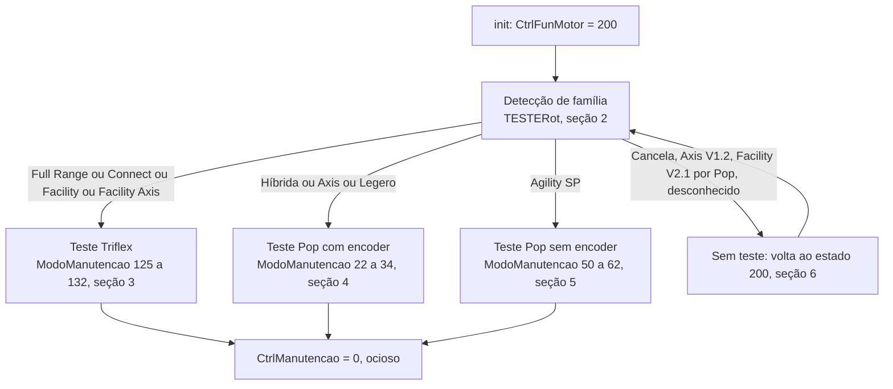
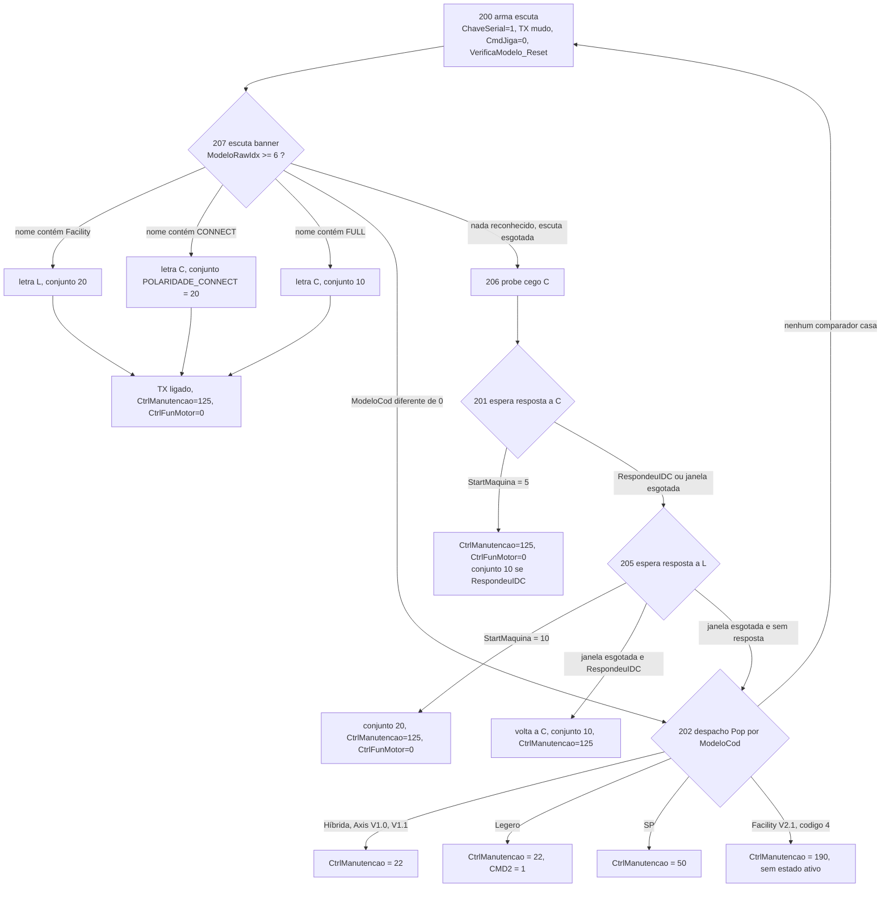
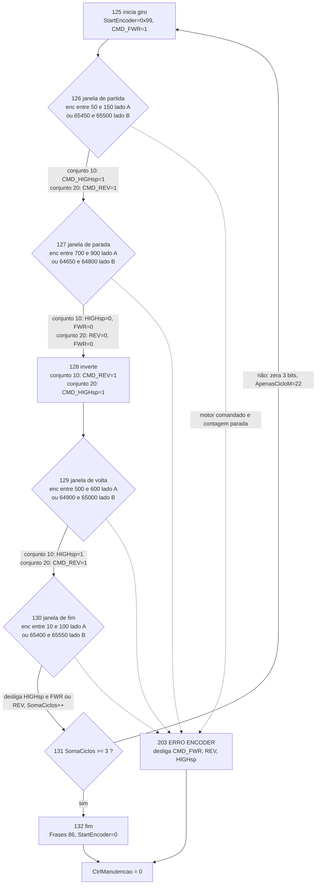
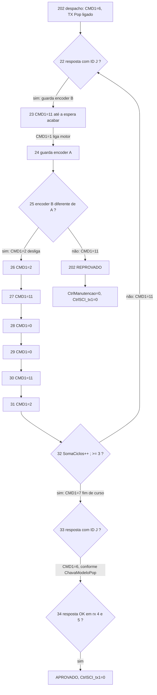

# Máquina de estados da jiga de manutenção, por família

Origem: `docs/TesteProgManutencao/` (firmware XMC1100 da jiga). Este documento descreve **o que a jiga decide e comanda em cada estado**, família por família. Os frames, a camada UART e a forma de detectar a família estão em `docs/jiga-protocol.md` e não são repetidos aqui. Quando preciso, aponto a seção (ex.: "protocolo §3.1").

Legenda de procedência de cada afirmação:

- **[código]**: decorre do código executável (não comentado).
- **[comentário]**: vem de comentário do código (regra do produto ou intenção do autor).
- **[inferido]**: dedução minha. Precisa de confirmação.

Fora de escopo, por pedido: hardware, drivers DAVE, LCD (exceto os textos mostrados ao operador), buzzer, funções de suporte e todo controle de tempo.

Escopo: só o que o código ativo executa e que é alcançável a partir do `main`. Código comentado, estados que nenhum código ativo alcança e campos, bits ou constantes que nada usa foram retirados.

## 0. Convenções

- Há duas variáveis de estado. `CtrlFunMotor` é o estado da **detecção** (arquivo `TESTERot.c`). `CtrlManutencao` é o estado do **teste** (arquivo `ModoManutencao.c`). A detecção termina com `CtrlFunMotor = 0` e entrega o teste ao `CtrlManutencao` escolhido. [código]
- No laço do `main`, a ordem por volta é `TESTERot()`, `VerificaModelo()`, `ModoManutencao()`, `SCI_TX()`. [código]
- **"(espera)"** na coluna de entrada significa que o estado só age depois que `TempoMaquina` zera. Os valores dessas esperas foram omitidos por escopo. Eles definem, por exemplo, quanto tempo o motor fica ligado em cada passo. Estão listados como lacuna (§11, item 1). [código]
- `CMD1`, `CMD2`, `CMD3` são os bytes de comando do pedido Pop (protocolo §3.2). `CMD_*` são bits de `CmdJiga` do pedido Triflex (protocolo §3.1.1). O significado dos valores de `CMD1` é **[inferido]** (protocolo §3.2.1).
- A jiga repete o pedido continuamente (lockstep), e isso também mantém a central em modo escravo: se os pedidos pararem, ela volta ao modo mestre (protocolo do seletor) por timeout (`jiga-protocol.md` seção 1.3; valor desconhecido, `open-questions.md` J1). Um estado que "liga" um comando apenas altera `CmdJiga` ou `CMD1/2`; o valor vai no próximo pedido. [código] protocolo §5.
- **Texto ao operador**: vem da tabela `Frases_LCD[]` de `Flash.c`, indexada pelo número entre colchetes. Textos de 16 caracteres por linha (linha 1 + linha 2). Textos que não vêm da tabela estão marcados "literal no código".
- O estado final de qualquer teste é `CtrlManutencao = 0` e `CtrlFunMotor = 0`. Nenhum dos dois tem `case 0` ativo, então a jiga fica ociosa. [código]

## 1. Visão geral

Famílias e fluxo de teste:

| Família | Detecção | Fluxo de teste | Seção |
|---|---|---|---|
| Full Range | Banner com `"FULL"`, ou probe `'C'` com ID 0 | Triflex, conjunto 10 | 3 |
| Connect | Banner com `"CONNECT"`, ou probe `'C'` com ID `'C'` | Triflex, conjunto 20 (banner) ou 10 (probe) | 3.4 |
| Facility | Banner com `"Facility"`, ou probe `'L'` | Triflex, conjunto 20 | 3 |
| Facility Axis / Triflex IA | Igual ao Facility (resposta de 19 bytes) | Idêntico ao Facility | 3.5 |
| Agility Híbrida V1.4 a V1.7 | Banner na `ModeloTabela` | Pop com encoder, `ChavaModeloPop = 1` | 4 |
| Agility Axis V1.0 e V1.1 | Banner na `ModeloTabela` | Idêntico à Híbrida | 4 |
| Pop/Legero V2.3 a V2.6 (DZ) | Banner na `ModeloTabela` | Pop com encoder, `ChavaModeloPop = 2`, `CMD2 = 1` | 4 |
| Agility SP V1.0 a V1.3 | Banner na `ModeloTabela` | Pop sem encoder, `ChavaModeloPop = 5` | 5 |
| Agility Cancela V1.3 a V1.6, Axis V1.2 | Banner na `ModeloTabela` | **Nenhum** (comparador comentado ou ausente) | 6 |

[código] `TESTERot.c` cases 207 e 202.

---

## 2. Detecção da família (`CtrlFunMotor`)

Resumo do fluxo. O critério de decisão por palavra-chave e as variáveis estão em protocolo §6.

### 2.1 Estados da detecção (todos os `case` ativos de `TESTERot.c`)

| Estado | Condição de entrada | Ação / comando enviado | Aprovação ou falha | Próximo estado | Texto ao operador | Proc. |
|---|---|---|---|---|---|---|
| **200** arma a escuta | `init()` põe `CtrlFunMotor = 200`. Também reentra do 202 sem identificação. Age quando `TempoMaquina` zera (espera) | Nenhum frame enviado (`CtrlSCI_tx1 = 0`, mudo). Põe `ChaveSerial = 1`, `gCtrlSCI_rx1 = 1`, `StartMaquina = 0`, `RespondeuIDC = 0`, `CmdJiga = 0`. Chama `VerificaModelo_Reset()` | Sem condição de falha | 207 | `Frases_LCD[0]`: linha 1 `\|PROG DE CICLOS\|`, linha 2 `JIGA_MODELO_V1.0` | [código] |
| **207** escuta o banner | Vem do 200 | Não transmite. Se `ModeloRawIdx >= 6`, extrai o nome (`VerificaModelo_ExtraiNome`) e testa nesta ordem: `"Facility"`, `"CONNECT"`, `"FULL"`, depois `ModeloCod != 0` | Reconhece Triflex: ver 2.2. Reconhece Pop: ver abaixo. Nome ausente ou não reconhecido até esgotar a escuta: falha, cai no 206 | Triflex reconhecido: `CtrlFunMotor = 0` e `CtrlManutencao = 125`. Pop (`ModeloCod != 0`): 202 com `ChaveSerial = 2`, TX mudo, `gCtrlSCI_rx2 = 1`. Nada: 206 | Tela temporária de medição (literal no código, ver abaixo) | [código] |
| **206** probe cego `'C'` | Vem do 207 (escuta esgotada sem nome) | `BufferSCI_tx1[2] = 'C'`, `CtrlSCI_tx1 = 1` (liga o TX Triflex), `StartMaquina = 0`, `RespondeuIDC = 0`, `CmdJiga = 0` | Sem condição | 201 | Nenhum | [código] |
| **201** espera resposta a `'C'` | Vem do 206 | Nenhum comando novo | Aprova se `StartMaquina == 5` (ID `'C'` ou 0 recebido): `CtrlManutencao = 125`, `CtrlFunMotor = 0`, e `IsolaSensorModelosInversores = 10` se `RespondeuIDC`. Senão, se `RespondeuIDC` sobe ou a janela esgota: tenta `'L'` | Aprovado: fim da detecção (teste Triflex). Senão 205, com `ChaveSerial = 1`, `BufferSCI_tx1[2] = 'L'`, `CtrlSCI_tx1 = 1`, `StartMaquina = 0` | Nenhum | [código] |
| **205** espera resposta a `'L'` | Vem do 201 | Nenhum comando novo | Aprova se `StartMaquina == 10`: `IsolaSensorModelosInversores = 20`, `CtrlManutencao = 125`, `CtrlFunMotor = 0`. Se a janela esgota com `RespondeuIDC`: volta o ID para `'C'`, conjunto 10, `CtrlManutencao = 125`, `CtrlFunMotor = 0`. Se esgota sem nenhuma resposta: vai para o Pop | Aprovado: teste Triflex. Sem resposta: 202 com `ChaveSerial = 2`, `CtrlSCI_tx1 = 0`, `gCtrlSCI_rx2 = 1`, `StartMaquina = 0` | Nenhum | [código] |
| **202** despacho Pop | Vem do 207 ou do 205. Age depois de uma espera para o Pop inicializar | Liga o TX Pop (`CtrlSCI_tx1 = 10`), `gCtrlSCI_rx2 = 1`, `StartMaquina = 0`, `CtrlFunMotor = 0`. Os valores de `CtrlManutencao`, `CMD1`, `CMD2` e `ChavaModeloPop` estão na tabela 2.3 | Falha: nenhum comparador casa com `ModeloCod` | Casou: o estado da coluna "destino" da tabela 2.3. Falhou: 200 (recomeça a detecção, com `ChaveSerial` voltando a 1 no 200) | Nenhum | [código] + [comentário] (o recomeço é explicado em comentário) |

Tela temporária do 207 após reconhecer um Triflex (literal no código, marcada pelo autor como "MEDIÇÃO TEMPORÁRIA - REMOVER DEPOIS"): linha 1 `RECONHECIDO:`, linha 2 o nome (`FACILITY`, `FULLRANGE` ou `CONNECT`) e o tempo desde o boot em ms. [código] + [comentário]

### 2.2 Decisão do case 207 para Triflex

| Palavra no nome | `BufferSCI_tx1[2]` (letra) | `IsolaSensorModelosInversores` | Família |
|---|---|---|---|
| `"Facility"` | `'L'` | 20 | Facility, Facility Axis |
| `"CONNECT"` | `'C'` | 20 (`POLARIDADE_CONNECT` em `TESTERot.c`) | Connect |
| `"FULL"` | `'C'` | 10 | Full Range |

Em todos: `CtrlSCI_tx1 = 1`, `gCtrlSCI_rx1 = 1`, `CtrlManutencao = 125`, `CtrlFunMotor = 0`. [código]

### 2.3 Despacho do case 202 (Pop)

Os comparadores são testados nesta ordem, e o primeiro que casa vale. [código]

| Famílias (`ModeloCod`) | Destino `CtrlManutencao` | `ChavaModeloPop` | `CMD1` | `CMD2` | Observação |
|---|---|---|---|---|---|
| Híbrida V1.4 a V1.7 (7, 8, 9, 10), Axis V1.0 e V1.1 (20, 21) | 22 | 1 | 6 | não alterado | O comparador lista `AXIS_V1_1` duas vezes e omite `AXIS_V1_2` |
| Legero V2.3 a V2.6 (2, 17, 18, 19) | 22 | 2 | 6 | 1 | |
| SP V1.0 a V1.3 (6, 14, 15, 16) | 50 | não usado | não alterado | não alterado | |
| Facility V2.1 (4) | 190 | não alterado | não alterado | não alterado | Não existe `case 190` ativo (§11, item 7) |
| Qualquer outro | nenhum | | | | Recomeça em 200 |

---

## 3. Teste Triflex: Full Range, Connect, Facility, Facility Axis

Estados `CtrlManutencao` 125 a 132, mais o 203 (erro de encoder). O fluxo é um só. A família entra pelo valor de `IsolaSensorModelosInversores`: 10 (conjunto Full Range) ou 20 (conjunto Facility). Os dois conjuntos diferem em quais bits de `CmdJiga` são ligados em cada giro (protocolo §3.1.2).

`PlsEncoder` é o contador de 16 bits da resposta Triflex (protocolo §4.3). Os testes de passagem são **janelas de posição**. Dois lados simétricos: o lado A conta a partir de ~0 para cima, e o lado B a partir de 65535 para baixo (virada do contador). `LadoMotorA` e `LadoMotorB` memorizam por qual lado o motor está passando (valor 0x33). [código] + [inferido] (a leitura "A = para cima, B = para baixo/wrap" é minha).

A seta pontilhada é o vigia de encoder (3.3), válido nos estados 125 a 130.

### 3.1 Estados 125 a 132

| Estado | Condição de entrada | Ação / comando enviado | Aprovação ou falha | Próximo estado | Texto ao operador | Proc. |
|---|---|---|---|---|---|---|
| **125** inicia o giro | Vem da detecção. Ou vem do 131 para repetir um ciclo. Para a primeira passagem exige espera, o produto pronto (~2 s reais desde a identificação, [comentário]) e `IsolaSensorModelosInversores` igual a 10 ou 20. Na reentrada, `ApenasCicloM == 22` basta | `StartEncoder = 0x99`, `CMD_FWR = 1`. O pedido seguinte já carrega o bit. Os dois conjuntos fazem o mesmo aqui | Sem falha própria. Se nenhuma condição vale, o estado fica esperando | 126 | Nenhum (a tela mostra a linha 2 `ENC:eeeee C:ccc` assim que `StartEncoder == 0x99`, literal no código) | [código] |
| **126** janela de partida | Vem do 125 (espera) | Lado A, `PlsEncoder` entre 50 e 150: `LadoMotorA = 0x33`. Lado B, entre 65450 e 65500: `LadoMotorB = 0x33`. Conjunto 10: liga `CMD_HIGHsp`. Conjunto 20: liga `CMD_REV` (mantém `CMD_FWR`) | Passa quando a posição cai em uma das janelas. Não há falha por posição, só o vigia (3.3) | 127 | Nenhum | [código] |
| **127** janela de parada | Vem do 126 (espera) | Lado A (`LadoMotorA == 0x33`), entre 700 e 900, ou lado B (`LadoMotorB == 0x33`), entre 64650 e 64800: zera `CMD_FWR` e `CMD_HIGHsp` (conjunto 10) ou `CMD_FWR` e `CMD_REV` (conjunto 20). Mantém o lado | Passa na janela | 128 | Nenhum | [código] |
| **128** inverte o sentido | Vem do 127 (espera) | Conjunto 10: liga `CMD_REV`. Conjunto 20: liga `CMD_HIGHsp` | Sem condição de posição | 129 | Nenhum | [código] |
| **129** janela de volta | Vem do 128 (espera) | Lado A (`LadoMotorA == 0x33`), entre 500 e 600, ou lado B (`LadoMotorB == 0x33`), entre 64900 e 65000. Conjunto 10: liga `CMD_HIGHsp` (junto com `CMD_REV`). Conjunto 20: liga `CMD_REV` (junto com `CMD_HIGHsp`) | Passa na janela | 130 | Nenhum | [código] |
| **130** janela de fim e contagem de ciclo | Vem do 129 (espera) | Conjunto 10: lado A entre 10 e 100, ou lado B entre 65400 e 65550: zera `CMD_HIGHsp` e `CMD_FWR` (`CMD_REV` continua ligado até o 131), `SomaCiclos++`. Conjunto 20: mesmas janelas, zera `CMD_HIGHsp` e `CMD_REV`, `SomaCiclos++` | Passa na janela. Atenção às atribuições de lado (3.2) | 131 | Nenhum | [código] |
| **131** conta ciclos | Vem do 130 (espera) | `SomaCiclos >= 3`: zera `CMD_REV`, `CMD_HIGHsp`, `CMD_FWR` e `StartEncoder = 0`. `SomaCiclos < 3`: zera os três bits, `ApenasCicloM = 22` | **Aprovado** com 3 ciclos contados (o comentário de outros trechos fala em "2 ciclos", mas a comparação é `>= 3`) | Aprovado: 132. Senão: 125 | Aprovado: `Frases_LCD[86]`, linha 1 ` Central Triflex`, linha 2 `  Aprovada !!!!` | [código] |
| **132** encerra | Vem do 131 aprovado (espera) | `CtrlManutencao = 0`, `ApenasCicloM = 0`, `StartEncoder = 0`. Não mexe em `CtrlSCI_tx1`: o TX Triflex continua pedindo | Sem condição | Ocioso (`CtrlManutencao = 0`) | Nenhum (continua a tela aprovada) | [código] |
| **203** erro de encoder | Entrada só pelo vigia (3.3) | Zera `CMD_FWR`, `CMD_REV`, `CMD_HIGHsp`, `StartEncoder = 0`, `ApenasCicloM = 0` | **Reprovado** por encoder | Ocioso (`CtrlManutencao = 0`). `CtrlSCI_tx1` não é zerado | `Frases_LCD[11]`, linha 1 `  ERRO ENCODER`, linha 2 `MOTOR SEM PULSO` | [código] |

### 3.2 Pontos sobre as janelas

- A condição de passagem por janela depende da posição lida no instante em que o estado é avaliado. Uma janela estreita pode ser atravessada entre duas leituras. A jiga atualiza o encoder a cada resposta válida. [inferido] (§11, item 5)
- Com `CMD_FWR` ligado no 125 e conjunto 20, o 126 liga `CMD_REV` **sem** desligar `CMD_FWR`. Os dois bits ficam em 1 até o 127. [código]
- No estado 130, os dois conjuntos gravam `LadoMotorA`/`LadoMotorB` de forma assimétrica. Conjunto 10, lado B passando: grava `LadoMotorA = 0x33` (e não B). Conjunto 20, lado A passando: grava `LadoMotorB = 0x33` (e não A). Provavelmente é cópia e cola, mas só afeta os testes de lado nos ciclos seguintes. [código] + [inferido]
- `LadoMotorA`/`LadoMotorB` nunca são zerados no código ativo (só recebem 0x33). [código] (§11, item 4)
- `SomaCiclos` nunca é zerado. Uma segunda execução sem reiniciar a jiga encontra o contador já em 3 ou mais, e o 131 aprova após o primeiro ciclo. [código] + [inferido] (§11, item 4)

### 3.3 Vigia de encoder (`Encoder_Watchdog`, roda a cada chamada do `ModoManutencao`)

| Condição | Efeito | Proc. |
|---|---|---|
| `StartEncoder == 0x99` e `CtrlManutencao` entre 125 e 130 e `IsolaSensorModelosInversores` é 10 ou 20 e (`CMD_FWR` ou `CMD_REV` ligado) | Se `PlsEncoder` não muda por um limite de tempo real de 5 s, força `CtrlManutencao = 203` | [código] |
| `CMD_HIGHsp` isolado | Não conta como motor girando (é seletor de velocidade) | [comentário] |
| Fora dessas condições | Rearma a referência, sem efeito | [código] |

Regra do produto registrada em comentário: na Triflex o encoder existe sempre. Dar comando de motor e a contagem não mudar é defeito de leitura. Nos Pop/Agility o vigia não roda de propósito, porque há modelo sem encoder. [comentário]

### 3.4 Connect

O Connect entra no mesmo fluxo 125 a 132. O que muda é só o valor de `IsolaSensorModelosInversores`, que depende do caminho de detecção. [código]

| Caminho de detecção | Letra do pedido | Conjunto | Efeito no teste |
|---|---|---|---|
| Banner `"CONNECT"` (case 207) | `'C'` | 20 (`POLARIDADE_CONNECT` de `TESTERot.c`) | Usa os comandos do Facility (3.1, coluna "conjunto 20") |
| Probe `'C'` respondido, case 201 com `RespondeuIDC` | `'C'` | 10 | Usa os comandos do Full Range |
| Probe `'L'` sem resposta mas `'C'` respondido, case 205 | `'C'` | 10 | Idem |

O comentário de `TESTERot.c` diz que o conjunto 10 "não funciona" para o Connect (ele para de responder quando o bit `CMD_HIGHsp` vira 1) e que o 20 é o outro conjunto aceito por produto neste projeto. O resultado em bancada do conjunto 20 não está registrado. [comentário] (§11, item 8).

Os códigos de modelo 23 a 26 (variantes do Connect, `VerificaModelo.c`) só mudam o texto do mostrador: `    TRIFLEX     CONNECT TESTE CL` (literal no código, igual para as quatro). Não alteram o fluxo. [código]

### 3.5 Facility e Facility Axis

- O Facility Axis / Triflex IA segue exatamente o fluxo do Facility (conjunto 20, letra `'L'`). A única diferença visível ao código é o frame de resposta de 19 bytes. [código] + [comentário]
- Não é a mesma coisa que o "Agility Axis V1.0 a V1.2", que é protocolo Pop (seção 4). [código]
- Pela via probe, `VerificaModelo()` mostra `Triflex Facility      V2.1` (literal no código) com `ModeloCod = MODELO_TRIFLEX`. Pela via banner o mostrador usa o texto da `ModeloTabela`. [código]

---

## 4. Teste Pop com encoder: Agility Híbrida, Agility Axis, Pop/Legero (DZ)

Estados `CtrlManutencao` 22 a 34, mais o 202 (reprovado). Os três modelos usam o mesmo fluxo de estados. Eles diferem no `CMD2` enviado em todos os pedidos desde o despacho (Legero: `CMD2 = 1`; Híbrida e Axis: `CMD2` inalterado, ver 2.3) e na confirmação do estado 33 (4.3). [código] Os frames Pop estão em protocolo §3.2 e §4.4. O encoder aqui é de 1 byte, `gBufferSCI_rx1[9]`, sem contador de 16 bits. O vigia da seção 3.3 **não roda** neste fluxo. [código]

### 4.1 Estados 22 a 34 e 202

| Estado | Condição de entrada | Ação / comando enviado | Aprovação ou falha | Próximo estado | Texto ao operador | Proc. |
|---|---|---|---|---|---|---|
| **22** espera resposta Pop | Vem do 202 de `TESTERot` (espera) ou do 32 (repetir ciclo). Já está transmitindo `CMD1 = 6` (despacho) ou `CMD1 = 11` (vindo do 32) | Nenhum comando novo | Passa se `gBufferSCI_rx1[2] == 'J'`: `StartEncoder = 0x99`, `ValorDefineEncB = rx[9]`. Sem resposta `'J'`: fica esperando, sem falha | 23 | Nenhum | [código] |
| **23** liga o motor | Vem do 22 | `CMD1 = 11` enquanto espera. Ao fim da espera, `CMD1 = 1` (liga motor, [inferido]) | Sem condição | 24 | Nenhum | [código] + [inferido] |
| **24** lê encoder A | Vem do 23 (espera) | `ValorDefineEncA = rx[9]` | Sem condição | 25 | Nenhum | [código] |
| **25** compara encoder | Vem do 24 (espera) | Se `ValorDefineEncB != ValorDefineEncA`: `CMD1 = 2` (desliga). Se iguais: `CMD1 = 11` | Aprovado: encoder mudou (o motor girou). **Reprovado**: encoder igual | Aprovado: 26. Reprovado: 202 | Nenhum no estado | [código] |
| **26** | Vem do 25 (espera) | `CMD1 = 2` | Sem condição | 27 | Nenhum | [código] |
| **27** | Vem do 26 (espera) | `CMD1 = 11` | Sem condição | 28 | Nenhum | [código] |
| **28** | Vem do 27 (espera) | `CMD1 = 0` (sentido oposto, [inferido]). | Sem condição | 29 | Nenhum | [código] + [inferido] |
| **29** | Vem do 28 (espera) | `CMD1 = 0` | Sem condição | 30 | Nenhum | [código] |
| **30** | Vem do 29 (espera) | `CMD1 = 11` | Sem condição | 31 | Nenhum | [código] |
| **31** | Vem do 30 (espera) | `CMD1 = 2` | Sem condição | 32 | Nenhum | [código] |
| **32** conta ciclos | Vem do 31 (espera) | `SomaCiclos++`. Se `>= 3`: `CMD1 = 7` (fim de curso). Senão: `CMD1 = 11` | Conta 3 ciclos | `>= 3`: 33. Senão 22 | Nenhum | [código] |
| **33** envia configuração | Vem do 32 (espera) | Se `rx[2] == 'J'`, envia `CMD1 = 6` com `CMD2` conforme 4.3. `StartEncoder = 0` | Sem resposta `'J'`: fica esperando, sem falha | 34 | Nenhum | [código] |
| **34** confirma | Vem do 33 (espera) | Nenhum comando novo | **Aprovado** se `rx[4] == 'O'` e `rx[5] == 'K'`. Sem OK: espera indefinida, sem falha | Aprovado: fim (`CtrlManutencao = 0`, `CtrlSCI_tx1 = 0`, o TX para) | `Frases_LCD[9]`: `    APROVADO    ` / `****************` | [código] |
| **202** reprovado | Vem do 25 (espera) | `CMD1 = 11` | **Reprovado** | Fim (`CtrlManutencao = 0`, `CtrlSCI_tx1 = 0`) | `Frases_LCD[10]`: `   REPROVADO    ` / `****************` | [código] |

O texto da `Frases_LCD[10]` usa o comentário "ERRO - motor não girou" no código.

### 4.2 Como o estado 22 pode ser entrado

1. Primeira vez: pelo despacho do `TESTERot` (case 202) com `CMD1 = 6` já armado, TX ligado em `CtrlSCI_tx1 = 10`. [código]
2. Repetição: pelo estado 32 enquanto `SomaCiclos < 3`. [código]

### 4.3 Configuração final (estado 33), por `ChavaModeloPop`

| `ChavaModeloPop` | Quem o atribui no despacho ativo | `CMD1` | `CMD2` | Proc. |
|---|---|---|---|---|
| 1 | Híbrida, Axis V1.0 e V1.1 | 6 | não alterado | [código] |
| 2 | Legero V2.3 a V2.6 (DZ) | 6 | 1 | [código] |
| 0 ou outro | | o estado 33 não faz nada | | [código] |

A **semântica** do `CMD2` (variante de configuração por modelo) é **[inferido]** (protocolo §3.2.1).

---

## 5. Teste Pop sem encoder: Agility SP

Estados 50 a 62. A diferença para a seção 4: **não há comparação de encoder e não há ramo de reprovação**. O comentário do bloco diz "teste pop sem encoder". [comentário] A mensagem do vigia de encoder diz que o SP pode ser modelo sem encoder, onde a contagem parada é informação sobre o produto e não defeito. [comentário]

| Estado | Condição de entrada | Ação / comando enviado | Aprovação ou falha | Próximo estado | Texto ao operador | Proc. |
|---|---|---|---|---|---|---|
| **50** | Vem do despacho do 202 (espera). TX Pop ligado com `CMD1` no valor anterior (inicial 11) | Nenhum | Passa se `rx[2] == 'J'`: `StartEncoder = 0x99`. Sem resposta: espera | 51 | Nenhum | [código] |
| **51** | Vem do 50 (espera) | `CMD1 = 1` (liga motor, [inferido]) | Sem condição | 52 | Nenhum | [código] + [inferido] |
| **52** | Vem do 51 (espera) | Nenhum | Sem condição | 53 | Nenhum | [código] |
| **53** | Vem do 52 (espera) | `CMD1 = 2` | Sem condição | 54 | Nenhum | [código] |
| **54** | Vem do 53 (espera) | `CMD1 = 2` | Sem condição | 55 | Nenhum | [código] |
| **55** | Vem do 54 (espera) | `CMD1 = 11` | Sem condição | 56 | Nenhum | [código] |
| **56** | Vem do 55 (espera) | `CMD1 = 0` | Sem condição | 57 | Nenhum | [código] |
| **57** | Vem do 56 (espera) | Nenhum comando novo | Sem condição | 58 | Nenhum | [código] |
| **58** | Vem do 57 (espera) | `CMD1 = 2` | Sem condição | 59 | Nenhum | [código] |
| **59** | Vem do 58 (espera) | `CMD1 = 2` | Sem condição | 60 | Nenhum | [código] |
| **60** conta ciclos | Vem do 59 (espera) | `SomaCiclos++`. Se `>= 3`: `CMD1 = 7`. Senão `CMD1 = 11` | 3 ciclos | `>= 3`: 61. Senão 50 | Nenhum | [código] |
| **61** configuração | Vem do 60 (espera) | Se `rx[2] == 'J'`: `CMD1 = 6`, `StartEncoder = 0`. `CMD2` não é alterado | Sem resposta `'J'`: espera | 62 | Nenhum | [código] |
| **62** confirma | Vem do 61 (espera) | Nenhum | **Aprovado** se `rx[4] == 'O'` e `rx[5] == 'K'`. Sem OK: espera indefinida | Fim (`CtrlManutencao = 0`, `CtrlSCI_tx1 = 0`) | `Frases_LCD[9]`: `    APROVADO    ` / `****************` | [código] |

Resultado: o SP só pode ser aprovado. A reprovação (`Frases_LCD[10]`) não existe neste fluxo. [código]

---

## 6. Famílias sem teste

| Família | O que acontece | Proc. |
|---|---|---|
| Agility Cancela V1.3 a V1.6 (código 3) | O banner é reconhecido na tabela, mas o comparador do case 202 está comentado. A detecção recomeça no 200, em repetição, e o teste nunca começa | [código] |
| Agility Axis V1.2 (código 22) | Entrada na `ModeloTabela`, mas o comparador omite `AXIS_V1_2`. Mesmo efeito da Cancela | [código] |
| Facility V2.1 (código 4) por via Pop | Despacha para `CtrlManutencao = 190`, que não tem `case` ativo. A jiga transmite pedidos Pop e fica parada | [código] + [inferido] |
| Triflex (código 1), Connect (códigos 23 a 26), desconhecido (0) no case 202 | Nenhum comparador casa: recomeça a detecção | [código] |

---

## 7. Textos mostrados ao operador (tabela `Frases_LCD` e literais)

Textos da tabela (`Flash.c`) usados em código ativo, com as linhas separadas em 16 + 16 caracteres:

| Índice | Linha 1 | Linha 2 | Usado em código ativo? |
|---|---|---|---|
| 0 | `\|PROG DE CICLOS\|` | `JIGA_MODELO_V1.0` | Sim: `init()` e case 200 |
| 9 | `    APROVADO    ` | `****************` | Sim: estados 34 e 62 |
| 10 | `   REPROVADO    ` | `****************` | Sim: estado 202 |
| 11 | `  ERRO ENCODER  ` | `MOTOR SEM PULSO ` | Sim: estado 203 |
| 86 | ` Central Triflex ` | `  Aprovada !!!!` | Sim: estado 131 |

[código] `Flash.c`.

Literais fora da tabela, mostrados em código ativo: [código]

| Quando | Texto | Origem |
|---|---|---|
| Após reconhecer um Triflex no 207 | `RECONHECIDO:` / `<nome> <ms>ms` | `TESTERot.c` (marcado como temporário) |
| Durante o teste, linha 2 (com `StartEncoder == 0x99`) | `ENC:eeeee C:ccc` (encoder de 5 dígitos, ciclos de 3 dígitos) | `MostraEncoderProAmiguinho()` em `TESTERot.c` |
| Identificação de Connect | `    TRIFLEX     CONNECT TESTE CL` | `VerificaModelo.c` |
| Identificação de Facility pela via probe | `Triflex Facility      V2.1` | `VerificaModelo.c` |
| Identificação por tabela | O nome da entrada de `ModeloTabela` que casou, ou o nome cru se nada casar | `VerificaModelo.c` |

---

## 8. Variantes da tabela de `VerificaModelo.h` e destino de teste

A tabela completa (código, constante, como é atribuído) está em protocolo §6.4. Aqui só o destino de teste de cada variante. [código]

| Código | Constante | Banner procurado (`strstr`) | Destino |
|---|---|---|---|
| 2 | `AGILITY_LEGERO_V2_3` | `"AGILITY LEGERO  V2.3"` | Seção 4, Legero |
| 17, 18, 19 | `AGILITY_LEGERO_V2_4/5/6` | `"AGILITY LEGERO  V2.x"` | Seção 4, Legero |
| 3 | `AGILITY_CANCELA_V1_3` (também mapeia V1.4, V1.5, V1.6) | `"AGILITY CANCELA V1.x"` | Seção 6, sem teste |
| 4 | `Triflex_Facility______V2_1` | `"Triflex Facility      V2.1"` | Normalmente reconhecido antes, no 207, pela palavra `"Facility"` (seção 3). Por via Pop, seção 6 |
| 6, 14, 15, 16 | `AGILITY_SP______V1_0/1/2/3` | `"AGILITY SP      V1.x"` | Seção 5 |
| 7, 8, 9, 10 | `AGILITY_HIBRIDA_V1_4/5/6/7` | `"AGILITY HIBRIDA V1.x"` | Seção 4, Híbrida |
| 20, 21 | `AGILITY__AXIS___V1_0/1` | `"AGILITY  AXIS   V1.0/1"` | Seção 4, Axis |
| 22 | `AGILITY__AXIS___V1_2` | `"AGILITY  AXIS   V1.2"` | Seção 6, sem teste |
| 1 | `MODELO_TRIFLEX` | Atribuído por `StartMaquina == 10` | Só mostrador |
| 23 a 26 | `TRIFLEX_CONNECT_*` | Chaves `"3.15"`, `"2.34"`, `"2.36"`, `"2.45"` | Só mostrador. O teste é o Triflex da seção 3 |

---

## 9. Cobertura dos estados numerados dos `switch`

Só entram neste documento os estados executados por código ativo e alcançáveis a partir do `main`. Código comentado e estados que nenhum código ativo alcança foram retirados.

### 9.1 `TESTERot.c`, `switch(CtrlFunMotor)`

Ativos: 200, 207, 206, 201, 205 e 202 (seção 2.1).

### 9.2 `ModoManutencao.c`, `switch(CtrlManutencao)`

| Estados | Seção |
|---|---|
| 22 a 34 e 202 | 4 |
| 50 a 62 | 5 |
| 125 a 132 e 203 | 3 |

O destino 190 é atribuído pelo `TESTERot.c` (Facility V2.1 pela via Pop, seção 2.3), mas não existe `case 190` ativo. [código]

### 9.3 Botões

Nenhum botão participa do fluxo ativo. [código] + [inferido]

---

## 10. Resumo por família

Para o resultado final (o que a jiga mostra, qual comando liga o motor e o que reprova):

| Família | Reprovação possível | Aprovação | Condições de aprovação (resumo) |
|---|---|---|---|
| Full Range (10) | Só `ERRO ENCODER` (vigia) | `Frases_LCD[86]` | 3 ciclos pelas janelas do 126 ao 130 |
| Connect | Idem | Idem | Conjunto 20 (banner) ou 10 (probe) |
| Facility (20) | Idem | Idem | 3 ciclos, comandos do conjunto 20 |
| Facility Axis | Idem | Idem | Idem Facility |
| Híbrida, Axis V1.0/1.1, Legero | `REPROVADO` no 25 (encoder igual) | `APROVADO` no 34 | Encoder muda ao ligar o motor, 3 ciclos, resposta `OK` à configuração |
| SP | Nenhuma | `APROVADO` no 62 | 3 ciclos, resposta `OK` à configuração |
| Cancela, Axis V1.2 | Sem teste | | |

---

## 11. Lacunas e perguntas que o código não responde

Marcadas como **L** (lacuna) ou **C** (contradição).

1. **L**: as esperas (`TempoMaquina`) foram omitidas por escopo. Elas definem quanto tempo cada comando de motor fica aplicado, quanto o motor gira antes de cada leitura de encoder (estados 23 a 25 e 50 a 59) e o intervalo entre comandos. Uma implementação no prog_wifi precisa desses valores, ou de uma regra equivalente (por exemplo "ligar o motor até o encoder mudar"), e o código só os dá em unidades da base de tempo do `Counter.c`, que corre junto com a velocidade do laço (comentários no código). Quem reescrever precisa decidir ou medir.
2. **L**: a ordem entre as chamadas `TESTERot()` e `VerificaModelo()` no mesmo laço faz o `ModeloCod` (usado pelo despacho Pop) só aparecer na volta seguinte (protocolo §6.2). A reescrita não precisa copiar isso, mas o código não diz se há algum caso em que o Pop depende dessa defasagem.
3. **L**: fim de teste. Depois de aprovar ou reprovar, a jiga fica ociosa (`CtrlFunMotor = 0`, `CtrlManutencao = 0`). **Nada reinicia a detecção** (200) no código ativo, exceto o ramo "modelo não identificado" do 202. **C**: o comentário do case 200 diz que a detecção reinicia ao "trocar o produto sem desligar a jiga", mas não há caminho no código ativo que leve de volta ao 200 depois de um teste. Não se sabe como o operador roda um segundo teste (reset?).
4. **L**: variáveis nunca zeradas: `SomaCiclos` (só incrementa), `LadoMotorA`, `LadoMotorB` (só recebem 0x33), `ApenasCicloM` (zerado só no 132 e no 203), `CMD2` (herdado entre testes). Em uma segunda execução sem reiniciar a jiga, o 131 e o 32/60 aprovam após o primeiro ciclo. O código não mostra se isso é intencional.
5. **L**: as janelas de encoder dos estados 126 a 130 são estreitas (80 a 200 contagens) e a passagem só é detectada se uma leitura cair dentro. O código não diz a velocidade do encoder nem a cadência exata de leitura necessária. Não há condição de falha se o encoder passa pela janela sem ser lido: o estado espera indefinidamente (o vigia só reage a contagem parada).
6. **L**: não há ramo de falha nem tempo limite nos estados 22, 33, 34, 50, 61 e 62 (Pop) nem em 126 a 130 (Triflex, exceto o vigia). A reprovação do Pop só existe no 25. O que o produto deve fazer para ser considerado reprovado nesses estados não está escrito.
7. **L**: o destino `CtrlManutencao = 190` (Facility V2.1 pela via Pop, e `Counter.c`) não tem `case` ativo. Se esse caminho for alcançável, a jiga transmite pedidos Pop e para sem estado.
8. **C/L**: o conjunto de polaridade do Connect. Pelo banner é 20, pelo probe é 10. O comentário diz que o 10 "não funciona", mas o probe ainda o usa. O resultado em bancada do conjunto 20 não está registrado (protocolo §6.5).
9. **L**: o significado de cada valor de `CMD1` e `CMD2` do Pop (1 = liga, 2 = desliga, 11 = repouso, 0 = sentido oposto, 7 = fim de curso, 6 = configuração) é **[inferido]** de comentários curtos como "comando motor" e "desliga motor". Não há tabela de definições. `CMD2` como "variante" também é inferido.
10. **L**: no segundo sentido (`CMD1 = 0`, estados 28 a 31) o fluxo Pop com encoder não compara nenhuma leitura de encoder. Não se sabe se a verificação do segundo sentido foi removida de propósito. O fluxo SP (50 a 59) também não compara nada.
11. **L**: a aprovação do Pop usa `rx[4] == 'O'` e `rx[5] == 'K'`, que também são os bytes [4] e [5] da resposta, lidos para outros fins nos sensores do Pop. A leitura direta do buffer compartilhado `gBufferSCI_rx1` não garante que seja um frame recente e completo (protocolo §7, item 9). Um estado de entrada `22`/`33` que lê `rx[2] == 'J'` pode ver um frame antigo.
12. **L**: o vigia de encoder compara `PlsEncoder` inteiro (16 bits) e não distingue sentido. Para o Pop (8 bits), a comparação `!=` aceita qualquer mudança, inclusive a virada do contador. Não há verificação de direção em nenhuma das famílias, só de passagem por janelas (Triflex).
13. **L**: o Facility Axis / Triflex IA é descrito nos comentários com ID `'P'`, que o `RX_SCI` rejeitaria (protocolo §7, item 12). Se o Axis responder `'P'`, ele nunca chega ao teste. O código não confirma qual ID o Axis responde.

## 12. O que foi lido para este documento

Lidos por inteiro: `TESTERot.c`, `ModoManutencao.c`, `Flash.c`, `VerificaModelo.c`, `VerificaModelo.h`, `SCI_tx1.c`, `main.c`, `Botao_centro.c`. Lidos em parte: `Counter.c` (linhas 90 a 220, os decrementos e o bloco de `StartBotCounter`). Consultados só por busca de texto (`grep`): `Sci.c`, `types.h`, `Ram.c`, `Ram.h`, `init.c`, `EncontraProduto.c`. `Defines.h` e `Sci.c` não foram relidos por mim neste passo (o conteúdo de `Sci.c` entra via `jiga-protocol.md`). Consultado e usado como referência de protocolo: `docs/jiga-protocol.md` (lido por inteiro, não editado).
